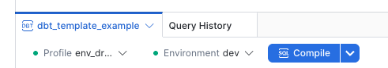
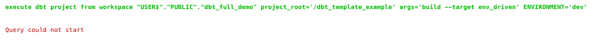

# dbt Full Demo — Setup Guide

> Architecture reference: [ARCHITECTURE.md](ARCHITECTURE.md)

---

## Prerequisites

- ACCOUNTADMIN (or equivalent) on a Snowflake account
- Access to Snowsight

---

## Step 1 — Create the GitHub API Integration

Before importing the repo you need a Git API integration in your Snowflake account. Run the following in a SQL Worksheet as **ACCOUNTADMIN**:

```sql
USE ROLE ACCOUNTADMIN;
CREATE API INTEGRATION IF NOT EXISTS GIT_HUB_INTEGRATION
  API_PROVIDER         = git_https_api
  API_ALLOWED_PREFIXES = ('https://github.com/')
  ENABLED              = TRUE;
```

This only needs to be done once per account. Skip this step if your account already has a GitHub integration.

---

## Step 2 — Import the repo into a Snowflake Git-backed Workspace

1. In Snowsight, open **Projects → Workspaces** and choose **New Workspace → From Git Repository**.
2. Paste the repo URL: `https://github.com/sfc-gh-timjones/dbt_full_demo`
3. Give the workspace a name (or leave the default).
4. Select the integration created in Step 1.
5. Choose **Public repository**.
6. Click **Create**.

You can now open and run the SQL scripts directly from the workspace file browser.

---

## Step 3 — Seed PROD with historical data

**Script:** `01_historical_data_generation.sql`

Open the script in a SQL Worksheet and run the entire file top to bottom.

What it does:
- Creates `PROD_RAW_DB` and the `ORACLE` schema.
- Creates all source tables with surrogate primary key columns matching the customer schema.
- Calls a stored procedure that generates synthetic provider and vendor data.

> `PRV_XREF` and `PRV_XREF1` are ~3.7 M rows each — allow a few minutes for those inserts to complete.

---

## Step 4 — Clone PROD into DEV and TEST

**Script:** `02_clone_prod_raw.sql`

Creates `DEV_RAW_DB` and `TEST_RAW_DB`, then clones `PROD_RAW_DB.ORACLE` into each at the schema level. The `PUBLIC` schema (tasks + procedures) is never touched — it stays empty in DEV and TEST.

---

## Step 5 — Create roles, databases, warehouses, and grants

**Script:** `03_analytics_env_setup.sql`

Creates:
- Roles: `DEV_ANALYTICS_RL`, `TEST_ANALYTICS_RL`, `PROD_ANALYTICS_RL`
- Databases: `DEV_ANALYTICS_DB`, `TEST_ANALYTICS_DB`, `PROD_ANALYTICS_DB`
- Warehouses: `DEV_ANALYTICS_WH`, `TEST_ANALYTICS_WH`, `PROD_ANALYTICS_WH`
- All USAGE, SELECT, and ownership grants

`TEST_ANALYTICS_DB` and `PROD_ANALYTICS_DB` ownership is transferred to their respective roles so only CI/CD (future phase) can write to them.

At the end of this script your current user is granted all three analytics roles.

---

## Step 6 — Set up the daily pipeline

**Script:** `04_incremental_data.sql`

Creates:
- `CHANGE_TRACKING` enabled on `PROV` and `VENDOR` in all three raw databases (required for the Dynamic Table)
- `INSERT_INCREMENTAL_DATA()` procedure — inserts ~225 records per call
- `DAILY_DATA_INSERT` task — fires at 8am MT; calls the insert procedure
- `REFRESH_DEV_TEST_CLONES()` procedure — re-clones `ORACLE` schema into DEV/TEST and re-applies grants
- `DAILY_CLONE_REFRESH` task — child task that fires automatically after `DAILY_DATA_INSERT` succeeds

The script resumes the child task (`DAILY_CLONE_REFRESH`) before the root task (`DAILY_DATA_INSERT`) — this order is required by Snowflake.

To trigger the pipeline immediately without waiting for 8am:

```sql
EXECUTE TASK PROD_RAW_DB.PUBLIC.DAILY_DATA_INSERT;
```

---

## Step 7 — Run dbt

The dbt project is run directly from the Snowflake workspace using the built-in dbt runner. Open the `dbt_template_example/` folder in the workspace file browser.

### Expand the output panel

Before running, expand the bottom output panel so you can see build results. Click the panel expand icon in the bottom toolbar (the two-rectangle icon):


Make sure the **`dbt_template_example`** tab is selected in the bottom panel — not **Query History**. The Profile and Environment dropdowns will only appear on the dbt tab.



### Run dev

In the bottom panel, confirm **Profile** shows `env_dr...` (env_driven). Set **Environment** to `dev` and click **Build**.


### Run test

Set **Environment** to `test` and click **Build**.


### Run prod

Set **Environment** to `prod` and click **Build**.


### Troubleshooting

If the build output shows **"Query could not start"**, click **Build** again and it will run successfully.



> Always run dev and test with the full build (the `build` command in `env.yml` includes `--full-refresh`). This rebuilds `dim_provider` from scratch and recreates `fct_provider_county_summary`'s change stream, which breaks when the source schema is replaced by the daily re-clone task.

---

## CI/CD (Future Phase)

Automating promotion from dev → test → prod via a CI/CD pipeline is the next phase. The intended flow:

```
PR merged to main
        │
        ├──────────────────────────────────────────────┐
        │                                              │
        ▼                                              ▼
┌─ Test Run ──────────────────┐      ┌─ Prod Run ──────────────────┐
│  role: TEST_ANALYTICS_RL    │      │  role: PROD_ANALYTICS_RL    │
│  dbt run --full-refresh     │      │  dbt run                    │
└─────────────────────────────┘      └─────────────────────────────┘
        │                                              │
        ▼                                              ▼
  TEST_ANALYTICS_DB                           PROD_ANALYTICS_DB
```

Because `TEST_ANALYTICS_DB` and `PROD_ANALYTICS_DB` are owned by their respective roles (set in `03_analytics_env_setup.sql`), only the CI/CD service account — not individual developers — can write to those databases. Authentication via OIDC (no stored passwords).
